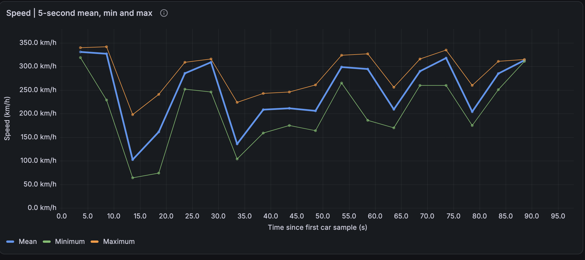
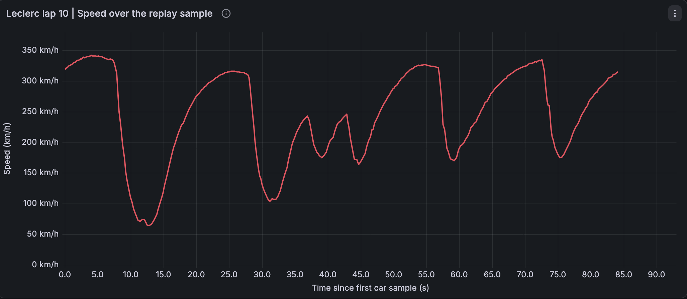
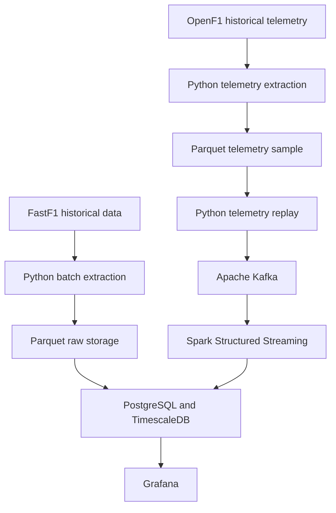

# F1 Analytics Platform

A data engineering portfolio project that combines a historical Formula 1
data warehouse with a near-real-time telemetry replay pipeline.

The project is developed for educational and portfolio purposes within
Refresh Academy. It demonstrates data engineering techniques in data
extraction, warehouse modeling, stream processing, and data-quality validation.

This is an unofficial project and is not affiliated with or endorsed by
Formula 1 or the FIA. Third-party data and materials remain subject to
their respective rights and applicable terms of use.

## Getting Started

### Get the source code

Clone the repository and enter its directory:

```bash
git clone https://github.com/refresh-academy/f1-analytics-platform-fanizzi.git
cd f1-analytics-platform-fanizzi
```

Run the remaining project commands from this directory.

### Prepare the local environment and inputs

- Install Git, uv, Docker with Docker Compose, and the Python version
  declared in [.python-version](.python-version).
- Follow step 0 of the [local run order](docs/run_order.md) to prepare
  the local `.env` using [.env.example](.env.example).
  Preserve an existing configuration.
- Obtain the required raw source files before running transformations or
  replay jobs. Cloning does not include local Parquet datasets, database
  contents, or Spark checkpoints. See [Data Sources](#data-sources)
  for acquisition details and the current FastF1 access limitation.
- Follow the batch build or coordinated streaming replay procedure in
  the [local run order](docs/run_order.md).

The verified local environment and completed checks are described below.

## Verified Local Environment

The project has been developed and run on an Intel Mac (`amd64`) with
macOS Monterey, Docker Desktop 4.41.2, and Docker Engine 28.1.1.
These versions describe the verified local setup, not minimum requirements
for other systems.

## Project Status

> Current phase: coordinated telemetry replay verified during publication.
> One Spark session stored events and calculated speed-window metrics.
> SQL confirmed 647 events, 18 windows, and 322 speed samples with no
> differences. Grafana speed-window updates were observed during publication.

The repository currently includes:

- [x] Git, GitHub repository, Python 3.13, and uv
- [x] Initial repository structure
- [x] FastF1 extraction of the Monza 2024 race
- [x] Raw and processed Parquet datasets, kept outside version control
- [x] PostgreSQL staging and analytical warehouse for this race
- [x] Driver, session, lap, and stint models
- [x] Repeatable loads and SQL data-quality checks
- [x] Analytical queries for laps, stints, strategies, and quality flags
- [x] Verified rebuild in a separate local PostgreSQL database
- [x] Grafana dashboard with lap and stint tables, tyre-compound chart,
  and Leclerc-Piastri lap-time comparison
- [x] Grafana comparison of Leclerc and Hamilton using race-result positions
- [x] Interactive Grafana median-sector comparison with driver selectors
- [x] Kafka 4.2.2 broker in KRaft mode, verified locally with Docker Compose
- [x] OpenF1 raw telemetry sample for Leclerc, Monza 2024 lap 10
- [x] Kafka replay of the 647-event Leclerc lap 10 sample,
  verified by reading it back from the broker
- [x] Spark Structured Streaming inspection of a completed Kafka replay
- [x] Spark Structured Streaming inspection while the Kafka replay is in progress
- [x] TimescaleDB hypertable for replay telemetry
- [x] Spark-to-TimescaleDB writes for completed and in-progress replays
- [x] Duplicate handling verified by republishing the same replay
- [x] Grafana telemetry replay dashboard with replay selection
- [x] Live replay visualization and completed replay review
- [x] Spark five-second speed-window metrics for completed replays
- [x] SQL reconciliation, checkpoint restart, and republication checks for metrics
- [x] Speed-window metrics verified during an in-progress replay
- [x] Grafana display of five-second speed mean, minimum, and maximum

On 2026-11-11, the replay at original pacing stored 647 events in
`f1_telemetry` across 18 nonempty micro-batches. SQL confirmed 322 car
telemetry events and 325 position events. A separate test on 2026-11-10 republished
the same replay ID and inserted zero additional rows. The primary key
combines replay ID, event time, and event ID to identify repeated samples
within each replay.

The rebuild used `f1_analytics_smoke` in the same PostgreSQL container.
All five SQL quality checks passed, and repeating the loads changed
no rows. A rebuild on another computer has not yet been tested.

The current race snapshot contains **1,008 laps from 20 drivers** and
**50 stints**. FastF1 marks 927 laps with `IsAccurate=True` and 81 with
`IsAccurate=False`; a False flag does not by itself mean that a lap time
is wrong or deleted. Race-control deletion information was unavailable
when this snapshot was extracted.

See [the local run order](docs/run_order.md) for build commands and
[the data-quality notes](docs/monza_2024_data_quality.md) for the
observed limitations.

## Project Overview

The platform processes Formula 1 data through two complementary workflows.

1. A batch pipeline for historical analysis.
2. A streaming pipeline that replays historical telemetry as a live event stream.

The batch pipeline organizes sessions, drivers, laps, sector times, stints,
tyre compounds, and race results in PostgreSQL.

The streaming pipeline publishes historical telemetry samples through Kafka
at controlled intervals. Spark Structured Streaming stores raw events and
calculates five-second speed metrics in TimescaleDB. The event writer can
run both queries in one Spark session with separate checkpoints, while
standalone metrics execution remains available. Grafana displays the raw
speed samples and window means, minima, and maxima. Coordinated processing
and speed-window display during publication have been verified locally.

## Project Goals

- Extract historical Formula 1 data with FastF1 and OpenF1.
- Preserve source data in Parquet format.
- Build reproducible and idempotent data pipelines.
- Design an analytical model for sessions, drivers, laps, and stints.
- Store analytical data in PostgreSQL and time-series data in TimescaleDB.
- Replay historical telemetry events through Apache Kafka.
- Process event streams with Spark Structured Streaming.
- Visualize historical and near-real-time metrics with Grafana.
- Run the infrastructure locally with Docker Compose.
- Document architectural decisions, data quality rules, and known limitations.

## Data Sources

The project acquires historical Formula 1 data through two routes:

| Workflow | Acquisition route | Data used |
|---|---|---|
| Batch warehouse | [FastF1 Python library](https://docs.fastf1.dev/) | Monza 2024 race laps, sector times, tyre information, driver details, and race results |
| Streaming replay | [OpenF1 HTTP API](https://openf1.org/docs/) | Car telemetry and position samples for Leclerc, driver 16, around lap 10 of the same race |

### Batch acquisition through FastF1

The batch extraction scripts use FastF1 to load the race session and save
`session.laps` and `session.results` as raw Parquet files. FastF1 is the
Python access library; its GitHub repository hosts the library's source code.

- [Lap extraction](src/extraction/extract_monza_2024_laps.py)
- [Race-result extraction](src/extraction/extract_monza_2024_results.py)

The verified batch snapshot contains 1,008 lap records from 20 drivers.
The project's transformations derive 50 stint records from those laps.

### Telemetry acquisition through OpenF1

The [telemetry extractor](src/extraction/extract_monza_2024_telemetry_sample.py)
queries the `laps`, `car_data`, and `location` endpoints under
`https://api.openf1.org/v1`. It selects session `9590`, driver `16`, and
lap `10`. The lap's reported start and duration define the sampling window;
OpenF1 describes lap start timestamps as approximate.

The preserved sample contains 322 car telemetry records and 325 position
records. A local `manifest.json` records the API base URL, extraction time,
source lap record, query filters, and row counts. Speed-window sample
counts, means, minima, and maxima are calculated by this project's Spark
pipeline from the source speed samples.

### Data availability and reproduction

Raw Parquet files, processed datasets, and download caches are kept locally
and excluded from Git. Cloning this repository provides the extraction and
processing code, but does not provide those local data files.

The verified batch rebuild reused the preserved local snapshot. New FastF1
timing-archive downloads require authenticated access; see the
[FastF1 archive access update](https://github.com/theOehrly/Fast-F1/issues/978).
The current batch extraction scripts do not include an authentication
setup, and fresh authenticated acquisition has not been verified with this
repository. The OpenF1 sample was acquired through its historical API.

The streaming component uses historical replay. Previously recorded telemetry
samples are published at controlled intervals to simulate data arriving from
a car during a session.

Each stored event preserves two timestamps.

- **Event time (`event_time`)** records when the sample occurred in the historical session.
- **Publication time (`published_at`)** records when the producer published the sample during replay.

## Telemetry Replay Dashboard

The [local telemetry dashboard](http://localhost:3000/d/monza-2024-telemetry-replay/monza-2024-telemetry-replay)
reads TimescaleDB through a dedicated read-only role. It includes:

- Stored event counts for the selected replay.
- Leclerc's speed in km/h against seconds since the first car telemetry event.
- Stacked publication counts in five-second buckets, split into car telemetry
  events and position events.
- Spark speed-window means, minima, and maxima for five-second event-time windows.

One car telemetry event is a timestamped measurement record with fields such
as speed, RPM, throttle, brake, and gear. One position event records spatial
coordinates. The sample contains 322 car telemetry events and 325 position
events for one driver.

The speed curve uses historical `event_time`. The publication chart groups
stored events by `published_at` and follows the dashboard time picker.
Counters, the raw speed curve, and speed-window metrics cover the full
selected replay. Publication buckets describe when stored events were
published; they do not measure
Spark processing time or end-to-end latency. These SQL buckets are separate
from Spark's event-time speed-window metrics.

For a running demo, use **Latest replay (auto)**, **Last 5 minutes**, and a
five-second refresh. Each replay is finite and lasts about 84 seconds at
original pacing. Grafana refresh, Spark's processing trigger, and the SQL
bucket width are three independent settings, each currently five seconds.

To review a completed demo, select its Replay ID and an absolute time range
covering its publication timestamps. Set automatic refresh to **Off** to
stop periodic dashboard queries. This does not stop Spark or database writes.
An absolute range keeps the publication chart's time boundaries fixed.
An empty time range produces **No data** in the publication chart; the stored
events remain in TimescaleDB. SQL publication timestamps are shown in UTC in
the verified setup, while the dashboard uses the browser's time zone.

See [the run order](docs/run_order.md) for setup and replay commands. Dashboard
queries are versioned under `sql/grafana_telemetry_*.sql`; the builder is
`grafana/build_telemetry_dashboard.py`.

## Five-Second Speed Metrics

`src/streaming/aggregate_monza_2024_stream.py` reads one replay from Kafka
and groups car telemetry by five-second historical event-time windows,
replay ID, session, and driver. It stores the sample count and speed mean,
minimum, and maximum in `public.telemetry_speed_5s` in TimescaleDB.
The mean is an arithmetic sample mean, not a time-weighted or whole-lap mean.
Position events and missing speed values do not contribute.

Spark retains unique `(event_id, speed)` pairs within each active window
to avoid counting repeated source samples. Update mode writes the latest
known aggregate values, including the final windows of a finite replay.
Stored rows can be updated as more samples arrive; their presence does
not imply that the watermark has finalized every window.

The ten-second watermark follows the maximum historical event time seen
by the query. Older observations can be excluded from the metrics.
Window state grows with the unique samples in each active window; this
approach is intended for the current small replay. The metrics query has
its own checkpoints, separate from the raw-event writer and inspection.

The event writer also accepts `--with-speed-metrics` to start event storage
and speed aggregation in one Spark session. Each query retains its own
checkpoint. The coordinator monitors both queries; a streaming failure or
an unexpected query stop in follow mode fails the job and closes the
shared session. Coordinated execution during a new replay was verified
locally on 2026-11-16.

On 2026-11-12, the completed-replay test stored **18 event-time windows**
covering **322 speed samples**. The independent SQL check in
`tests/sql/check_monza_speed_windows.sql` found no differences in window
coverage, interval width, sample counts, means, minima, or maxima.
Restarting from the same checkpoint and republishing the same Replay ID
both preserved these results. The republication run emitted three windows
and changed zero stored rows.

Grafana displays these metrics in **Speed | 5-second mean, min and max**.
Hover over the information icon beside the title for the panel description,
or over a point for its values.

On 2026-11-16, replay `88b5ab88-949e-46e8-9eba-50ff302b4efc` was published
at original pacing while the coordinated event and metrics queries were
running. Kafka acknowledged all 647 events. SQL confirmed 322 car telemetry
events, 325 position events, and 18 speed windows covering 322 samples.
The independent comparison reported zero mismatched windows. The
speed-window panel was observed updating during publication.

### Streaming telemetry replay: dashboard snapshots

These screenshots show the completed historical telemetry replay of
Leclerc's lap 10 at Monza 2024. Kafka carried the published events, Spark
Structured Streaming stored events and computed speed windows in
TimescaleDB, and Grafana visualized the results. During the same test,
the speed-window panel was observed updating as events were published.

**Sample-level speed:** individual speed samples from the stored streaming
replay, plotted against seconds since the first car telemetry sample.



**Five-second speed windows:** event-time aggregates computed by Spark:
arithmetic sample mean (blue), minimum (green), and maximum (orange).
Each point is positioned at its window end, relative to the first car
sample. The first and last windows may be partially filled.



## Implemented Architecture



## Delivery Strategy

The project will be implemented incrementally.

### Phase 1: Project Foundation

- Configure Git and GitHub.
- Configure Python and uv.
- Create the repository structure.
- Document the initial architecture.

### Phase 2: Historical Data Pipeline

- Extract one Formula 1 session.
- Inspect source columns and data types.
- Store raw data in Parquet format.
- Add validation and data quality checks.

### Phase 3: Analytical Data Warehouse

- Define table grain and business keys.
- Create dimension and fact tables.
- Load PostgreSQL without generating duplicates.
- Write analytical SQL queries.

### Phase 4: Visualization

- Connect Grafana to the analytical database with a read-only PostgreSQL
  role (verified locally).
- Build lap, stint, sector, and driver comparison dashboards (lap and
  stint tables, compound chart, and two-driver lap-time plot complete;
  race-result comparison and interactive sector medians complete).

### Phase 5: Telemetry Replay

- Publish historical telemetry events through Kafka (verified locally).
- Process events with Spark Structured Streaming (verified locally).
- Store replay telemetry in TimescaleDB (verified locally).
- Visualize event counts, speed, and publication buckets in Grafana
  (verified locally).
- Calculate five-second speed-window metrics in Spark (verified locally
  for completed and in-progress replays).
- Store calculated metrics in TimescaleDB (verified locally).
- Display speed-window means, minima, and maxima in Grafana (verified locally).
- Validate speed-window metrics during publication (verified locally).

### Phase 6: Reliability and Documentation

- Test restart and recovery behavior.
- Validate idempotent batch loads.
- Document operational commands and troubleshooting steps.
- Include dashboard screenshots (sample-level speed and speed windows included).
- Add an animated demonstration (planned).

## Technology Stack

| Area | Technology |
|---|---|
| Data sources | FastF1 (batch), OpenF1 (telemetry sample) |
| Programming language | Python |
| Python environment | uv |
| Raw storage | Parquet |
| Analytical database | PostgreSQL |
| Time-series database | TimescaleDB |
| Message broker | Apache Kafka |
| Stream processing | Apache Spark Structured Streaming |
| Visualization | Grafana |
| Infrastructure | Docker Compose |
| Database client | DBeaver |
| Development environment | Visual Studio Code |

## Development Principles

- Build and verify one component at a time.
- Keep raw data separate from transformed data.
- Define the grain of every analytical table.
- Make repeated pipeline executions safe.
- Store credentials outside version control.
- Document technical decisions and data limitations.
- Add technologies only when they have a clear architectural role.

## Author

Vito Enrico Fanizzi
