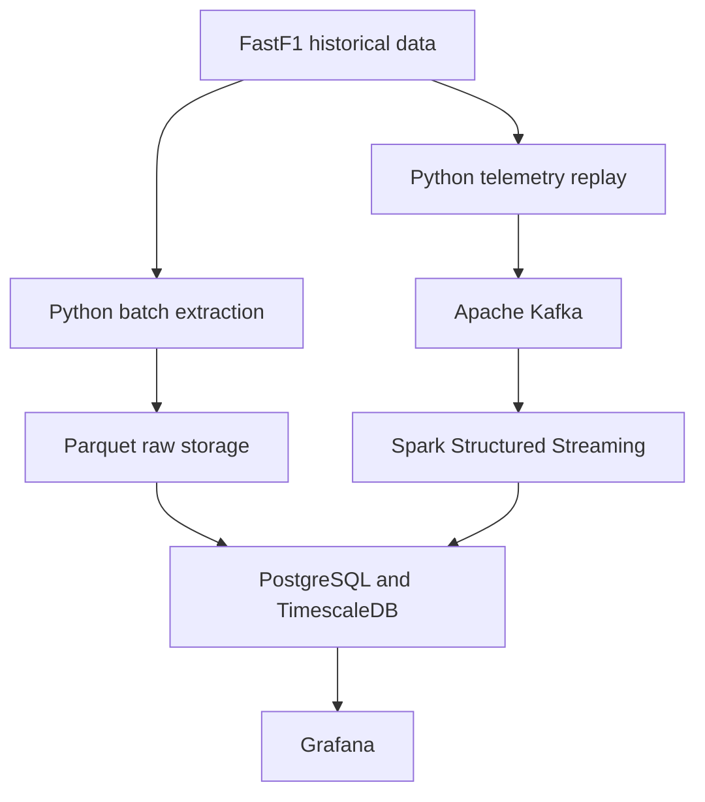

# F1 Analytics Platform

A data engineering portfolio project that combines a historical Formula 1
data warehouse with a near-real-time telemetry replay pipeline.

The project is developed as a learning and portfolio initiative within
Refresh Academy.

## Project Status

> Current phase: project setup and local development environment configuration.

The repository currently includes:

- [x] Local Git repository
- [x] Private GitHub repository
- [x] Python environment managed with uv
- [x] Python 3.13 project configuration
- [ ] Initial repository structure
- [ ] FastF1 data extraction
- [ ] Raw Parquet storage
- [ ] PostgreSQL data warehouse
- [ ] Data quality checks
- [ ] Kafka telemetry replay
- [ ] Spark Structured Streaming processing
- [ ] TimescaleDB telemetry storage
- [ ] Grafana dashboards

## Project Overview

The platform will process Formula 1 data through two complementary workflows:

1. A batch pipeline for historical analysis.
2. A streaming pipeline that replays historical telemetry as a live event stream.

The batch pipeline will organize sessions, drivers, laps, sectors, stints,
compounds, and telemetry metadata into an analytical data warehouse.

The streaming pipeline will publish historical telemetry samples at controlled
intervals, process them with time-based calculations, and update live
visualizations.

## Project Goals

- Extract historical Formula 1 data with FastF1.
- Preserve source data in Parquet format.
- Build reproducible and idempotent data pipelines.
- Design an analytical model for sessions, drivers, laps, and stints.
- Store analytical data in PostgreSQL and time-series data in TimescaleDB.
- Replay historical telemetry events through Apache Kafka.
- Process event streams with Spark Structured Streaming.
- Visualize historical and near-real-time metrics with Grafana.
- Run the infrastructure locally with Docker Compose.
- Document architectural decisions, data quality rules, and known limitations.

## Data Source

The project uses FastF1 to access historical Formula 1 timing and telemetry
data.

Because public live Formula 1 telemetry APIs are limited, the streaming
component will use a historical replay approach. Previously recorded telemetry
samples will be published at controlled intervals to simulate data arriving
from a car during a session.

The replay will preserve two separate time concepts:

- **Event time:** when the telemetry sample occurred in the historical session.
- **Processing time:** when the sample is published and processed during replay.

## Planned Architecture

## Delivery Strategy

The project will be implemented incrementally.

### Phase 1: Project Foundation

- Configure Git and GitHub.
- Configure Python and uv.
- Create the repository structure.
- Document the initial architecture.

### Phase 2: Historical Data Pipeline

- Extract one Formula 1 session.
- Inspect source columns and data types.
- Store raw data in Parquet format.
- Add validation and data quality checks.

### Phase 3: Analytical Data Warehouse

- Define table grain and business keys.
- Create dimension and fact tables.
- Load PostgreSQL without generating duplicates.
- Write analytical SQL queries.

### Phase 4: Visualization

- Connect Grafana to the analytical database.
- Build lap, stint, sector, and driver comparison dashboards.

### Phase 5: Telemetry Replay

- Publish historical telemetry events through Kafka.
- Process events with Spark Structured Streaming.
- Calculate window-based metrics.
- Store telemetry and processed metrics in TimescaleDB.

### Phase 6: Reliability and Documentation

- Test restart and recovery behavior.
- Validate idempotent batch loads.
- Document operational commands and troubleshooting steps.
- Add dashboard screenshots or an animated demonstration.

## Planned Technology Stack

| Area | Technology |
|---|---|
| Data source | FastF1 |
| Programming language | Python |
| Python environment | uv |
| Raw storage | Parquet |
| Analytical database | PostgreSQL |
| Time-series database | TimescaleDB |
| Message broker | Apache Kafka |
| Stream processing | Apache Spark Structured Streaming |
| Visualization | Grafana |
| Infrastructure | Docker Compose |
| Database client | DBeaver |
| Development environment | Visual Studio Code |

## Development Principles

- Build and verify one component at a time.
- Keep raw data separate from transformed data.
- Define the grain of every analytical table.
- Make repeated pipeline executions safe.
- Store credentials outside version control.
- Document technical decisions and data limitations.
- Add technologies only when they have a clear architectural role.

## Author

Vito Enrico Fanizzi
